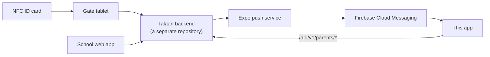

# Bantay Aral — the parent app

The parent companion to **Bantay Aral**, a school attendance system for
Philippine high schools. A student taps an NFC ID card at the school gate, and
this app tells their parents: it shows today's taps per child, keeps a feed of
notifications, and buzzes the phone when a child arrives or leaves.

Built with Expo (React Native) for Android first. The first pilot is Balanga
City National Science High School, about 500 students.

## Getting started

You need Node 24.3 or newer.

```powershell
npm install
npx expo start
```

Scan the QR code with **Expo Go** on an Android phone on the same Wi-Fi.
`docs/COMMANDS.md` has everything else, including what to do when it doesn't
work.

## How this fits together

This app holds **no business rules**. The server decides whether a tap is a
time in or a time out, whether a child is late or absent, who gets notified,
and what a parent is allowed to see. The app shows what it's told.



"Talaan" is the backend's code name and is never shown to a parent — everything
a parent sees says Bantay Aral.

## The docs

| File | What's in it |
|---|---|
| `docs/PLAN.md` | Steps M1 to M8 to a working demo, with a checkbox per task |
| `docs/TALAAN-API.md` | The API contract. It wins over every other file here |
| `docs/PRODUCT-RULES.md` | What the server decides, the words to use, the field rules |
| `docs/DESIGN.md` | How to use the UI design, and the rules that hold regardless |
| `docs/DESIGN-QUESTIONS.md` | Where the mockup and the server disagree, and what to do |
| `docs/API-CLIENT.md` | How the app talks to the server: the token, the checking, the errors |
| `docs/SERVER.md` | Which server to talk to, the demo data, testing a real push |
| `docs/COMMANDS.md` | Every command, grouped by task |
| `docs/BUILD-LOG.md` | How each step was actually built |
| `docs/LEARNING-LOG.md` | Plain-language answers to things that came up |
| `docs/PROBLEMS-LOG.md` | Every problem hit, and how it was resolved |
| `docs/recipes/` | A reproducible checklist per step |

## Layout

```
app.config.ts          the app's name, id and scheme — permanent once published
src/app/               the screens (Expo Router: one file per route)
src/components/brand/  the logo, drawn as vectors
src/theme/             every colour, size, space and corner
src/strings.ts         every word a parent reads
scripts/               the colour-literal check that CI runs
reference/             data copied from the backend; not app code
design/                the owner's UI design
```

## The rules that matter most

- **Colours, sizes and spacing come from `src/theme`.** Never a literal in a
  component — `npm run check:colors` fails the build on one.
- **Students are minors.** No personal data in logs, ever. The token lives only
  in secure storage. No analytics without the owner's approval.
- **Every answer from the server is checked** before it's used, and unknown
  fields are ignored so a new one can't break the app.
- **Every screen has loading, empty, error and success states**, works on a
  360-point phone, and survives large text.
