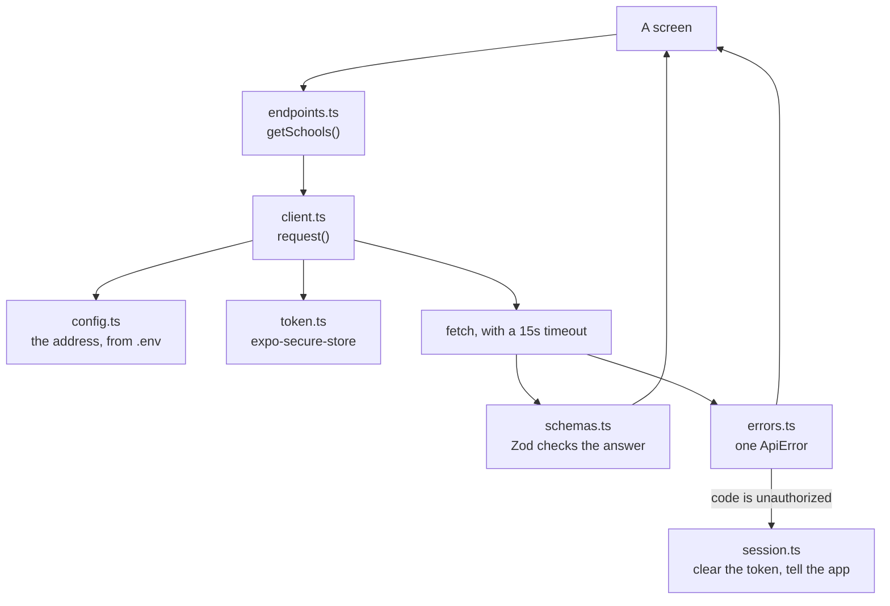

# The API client

Everything the app sends to or receives from Talaan goes through `src/api/`.
One place for the address, the token, the checking and the errors, so a screen
never has to think about any of it.

The contract it implements is `docs/TALAAN-API.md`, which wins over this file.

## How the pieces fit



| File | What it owns |
|---|---|
| `config.ts` | The server's address, from `EXPO_PUBLIC_API_URL` |
| `token.ts` | The sign-in token, in secure storage only |
| `session.ts` | What happens when the sign-in is gone |
| `schemas.ts` | Every answer's shape, in Zod |
| `errors.ts` | One `ApiError` for every kind of failure |
| `client.ts` | The one `request()` everything goes through |
| `endpoints.ts` | One typed function per address |

## The five rules it enforces

**1. The address is never hard-coded.** It comes from `EXPO_PUBLIC_API_URL`,
read the first time it is needed rather than when the module loads — throwing
at import time would crash the app before a screen could explain why.

Outside development it must be `https`. Android blocks plain `http` in a
release build, so this fails early and loudly instead of on a parent's phone.

**2. Every answer is checked.** `z.object` drops keys it does not know, which
is exactly what the contract asks for: a field the server adds later can never
break a phone already in someone's hands.

```ts
export const schoolSchema = z.object({ id: z.string(), name: z.string() });
```

An answer that does not match is an error, not a guess.

**3. One error type.** Every failure becomes an `ApiError` with a `kind`:

| `kind` | When | What a parent sees |
|---|---|---|
| `server` | The server answered in the contract's error shape | The server's own `message`, unchanged |
| `network` | No answer at all: no internet, server down, timed out | "Can't reach Bantay Aral right now…" |
| `response` | An answer arrived but was not the contract | "Something went wrong." |
| `config` | `EXPO_PUBLIC_API_URL` is missing | "Something went wrong." |

The server's messages are already plain, friendly English, so they are shown
exactly as they arrive (`docs/PRODUCT-RULES.md`).

**4. Only `unauthorized` signs a parent out.**

```ts
if (apiError.code === "unauthorized") {
  await signOutLocally();
}
```

This branches on the **code**, never on the status. `wrong_credentials` is also
a 401 (`docs/TALAAN-API.md:213`), so branching on the status would sign a
parent out every time they mistyped their password.

There is a second half to this rule. When the body **cannot be parsed at all**
— HTML from a proxy, a CDN login page — there is no code to read, and the
contract is absolute: "Any `401` means signed out" (`docs/TALAAN-API.md:38`).
So an unparseable 401 signs out on the **status**, before the error is thrown.
An unparseable 500 does not.

`signOutLocally()` clears the token and calls a handler the app registers. It
guards against firing twice, because a screen that loads a parent and their
children makes two requests that can fail together.

**5. Nothing private is ever kept on an error.** An `ApiError` holds the code,
the server's message, which fields failed, the status and the path — and
nothing else. Never the request body, which on sign-in is the parent's
password. Never headers, never the token, never a whole response.

Where development logging exists it prints field *paths*, never values:

```
[api] /api/v1/parents/schools did not match the contract: schools.0.id
```

## Two shapes of call

Four addresses answer `204` with no body at all, and `response.json()` throws
on an empty one. So there are two functions:

```ts
// An answer with a body, checked against a schema
const { schools } = await request({
  path: "/api/v1/parents/schools",
  auth: false,
  schema: schoolsResponseSchema,
});

// 204, no body: logout, read, read-all, push-tokens
await requestNoContent({ method: "POST", path: "/api/v1/parents/logout" });
```

## Why paths are full paths

`path` carries the whole path, including `/api/v1/...`, and `config.ts` holds
only the bare origin. Photos live at `/api/v1/photos/<key>`, outside
`/parents` (`docs/TALAAN-API.md:62`), so baking the `/parents` prefix into
`request()` would make photos the awkward exception.

## The timeout

React Native's `fetch` has no timeout of its own, so a server that accepts a
connection and then says nothing would hang forever. An `AbortController` ends
it at 15 seconds, and the parent sees the same "no answer" message as if they
had no internet — which, to them, is the same thing.

## Quick recipes

**Add an address.** Put its shape in `schemas.ts`, then a function in
`endpoints.ts`:

```ts
export async function getMe(): Promise<Me> {
  return request({ path: "/api/v1/parents/me", schema: meSchema });
}
```

Nothing else changes: the token, the errors and the sign-out are already
handled. Add the schema only when the step that uses it arrives, so the app
never carries code for a screen that does not exist.

**Show an error on a screen.** `error.message` is always safe to show. For a
field-by-field form error, read `error.fields`:

```ts
if (error instanceof ApiError && error.fields) {
  // { email: "Enter a valid email address" }
}
```

**React to being signed out.** Register once, at startup:

```ts
onSignedOut(() => router.replace("/sign-in"));
```

**Test a new address.** `src/api/__tests__/client.test.ts` has a fake server:
`answer(status, body)` builds a response and `serverError(code, message)`
builds the contract's error shape. Mock `globalThis.fetch` and assert on
`error.kind` and `error.code`.

**Point at a different server.** Change `EXPO_PUBLIC_API_URL` in `.env`, then
`npx expo start --clear`. Environment variables are baked in when the bundle is
built, so a restart without `--clear` keeps the old one.
