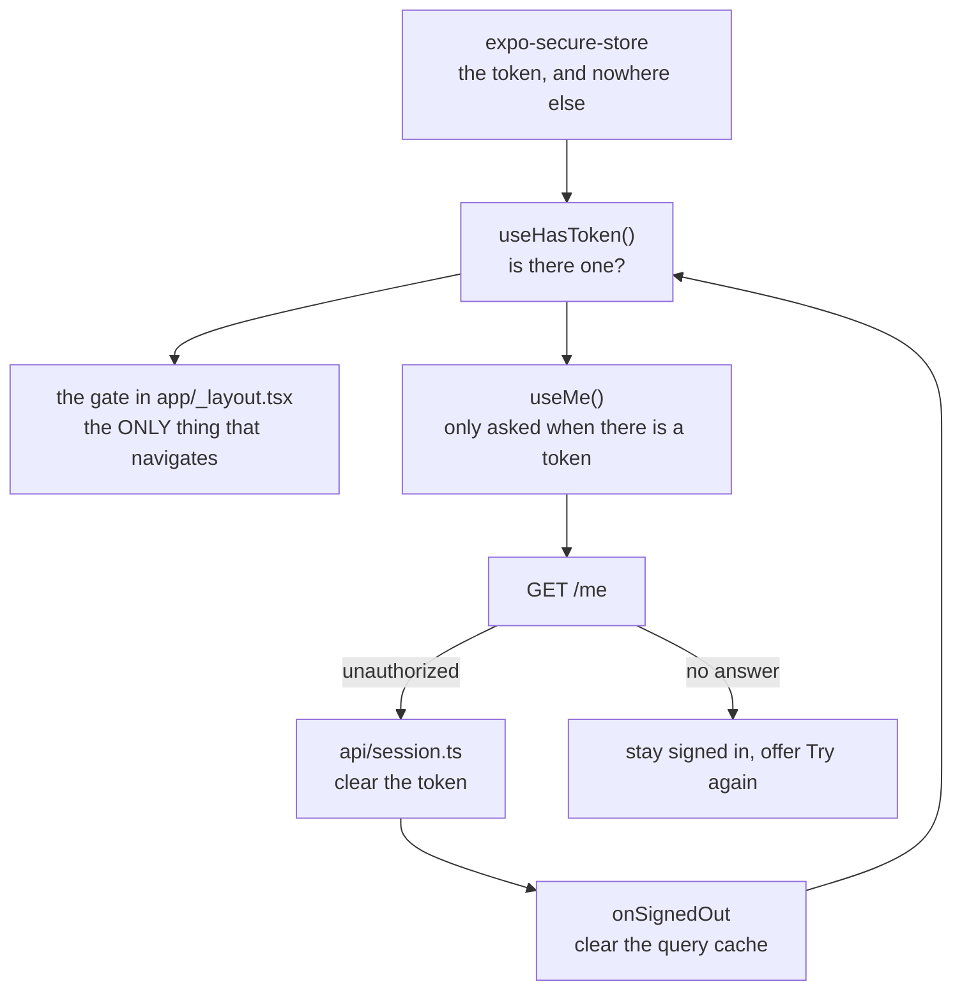

# Signing in

How the app knows who a parent is, and what happens when it stops knowing.

The rules come from `docs/TALAAN-API.md` and `docs/PRODUCT-RULES.md`, which
win over this file.

## The shape of it

| File | What it owns |
|---|---|
| `src/api/token.ts` | The token, in secure storage only |
| `src/api/session.ts` | Clearing it, and telling the app (M2) |
| `src/auth/session.ts` | The hooks: `useHasToken`, `useMe`, sign up / in / out |
| `src/auth/form-schemas.ts` | What the forms accept |
| `src/auth/device-label.ts` | The name this phone is known by |
| `src/auth/focus.ts` | Re-asking `/me` when the app returns |
| `src/app/_layout.tsx` | The gate |

## Two questions, deliberately apart

**Is there a token?** Decides which half of the app a parent is in. Answered
from secure storage, with no network at all, and held in React state rather
than the query cache — `src/auth/session-context.tsx` explains why putting it
in the cache hung the app (docs/PROBLEMS-LOG.md, P-009). A signed-out parent
never makes a request.

**Is the token still good?** Only `/me` can say. A parent with a token stays in
the signed-in half while that is being checked, and *stays there* if the check
fails for want of internet.

That split is the whole point. Collapsing it — treating any `/me` failure as
"signed out" — would throw a parent out of the app every time they opened it
on a jeepney with no signal.

| `/me` answered with | What a parent sees |
|---|---|
| the parent | their name |
| `kind: "network"` | "Can't reach Bantay Aral right now", **still signed in**, with "Try again" |
| `unauthorized` | the sign-in screen — the token was already cleared |

## One thing navigates

A `401` travels through four steps, and only the last one knows where sign-in
is:

1. `src/api/client.ts` sees `unauthorized` and clears the token
2. the `onSignedOut` handler clears the query cache
3. `useHasToken` flips to false
4. the gate in `_layout.tsx` moves the parent

Nothing else in the app calls `router.replace` for authentication. Two movers
race each other, and the loser's redirect lands after the winner's.

Note step 1 branches on the **code**, not the status: `wrong_credentials` is
also a 401, and signing out on the status would eject a parent every time they
mistyped a password. Where there is no readable code at all — a proxy
answering 401 with HTML — the status decides, because the contract is absolute
that any 401 means signed out.

## Staying signed in

A token lasts **30 days from its last use**, so any request keeps it alive.
`/me` runs on every app start and every return to the foreground, which is the
cheapest way to use it (`docs/PRODUCT-RULES.md`).

Returning to the foreground goes through TanStack Query's `focusManager`
(`src/auth/focus.ts`), not a hand-rolled `AppState` refetch — with both, every
query would run twice on each return. `/me` has a 30-second `staleTime` so a
run of focus changes, which Android produces around permission dialogs, does
not become a run of requests.

**M7 depends on this.** A sign-in left unused for 30 days is deleted along with
its push address, and the phone stops receiving notifications. Keeping the
session alive is keeping push alive.

## What never leaves the phone

- **The token** lives in `expo-secure-store`. Never AsyncStorage, never a log,
  never the query cache — the cache holds only *whether* a token exists.
- **The password** exists in the form's state and the request body. It is
  never put on an error, never logged, and `ApiError` is built to hold only a
  code, a message, field names, a status and a path.
- **`deviceLabel` is `Device.modelName`** ("Pixel 7"), never
  `Device.deviceName` — that one is set by the phone's owner and Expo's own
  example for it is "Vivian's iPhone XS". It is sent to the server and kept.
- **The email on "Sign in instead"** travels through an in-memory module, not
  a route parameter, so it never becomes navigation state.

## Quick recipes

**Add a screen only signed-in parents may see.** Put it under `src/app/(app)/`.
The gate does the rest; the screen itself needs no check.

**React to being signed out from somewhere else.** Don't. Read `useHasToken()`
and render accordingly — if a second place navigates, the two will race.

**Show the signed-in parent.** `const me = useMe(hasToken === true)`, then
branch on `me.isError` and `me.data` — **not** `me.isPending`, which stays
true for ever once the query is disabled. An error is not automatically a
sign-out; check `me.error` and show its message.

**Add a form.** A schema in `src/auth/form-schemas.ts` with the messages from
`docs/PRODUCT-RULES.md`, `zodResolver`, and `<Field>` per input. Map the
server's `error.fields` onto the form with `setError` so its messages land
under the same fields the app's own rules use.
