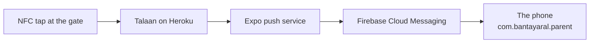
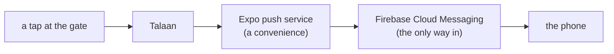

# Learning log

Short, plain-language answers to things that came up while building. Organised by topic, newest entry at the end of its section.

## Contents

- [Setting up the machine](#setting-up-the-machine)
  - [nvm installs a Node version without switching to it](#nvm-installs-a-node-version-without-switching-to-it)
  - [npm install changed package-lock.json on a new computer](#npm-install-changed-package-lockjson-on-a-new-computer)
- [Builds and installing the app](#builds-and-installing-the-app)
  - [Running the app on a phone without any store](#running-the-app-on-a-phone-without-any-store)
  - [Can the app get real pushes without the Play Store?](#can-the-app-get-real-pushes-without-the-play-store)
  - [APK or AAB: only one of them installs by hand](#apk-or-aab-only-one-of-them-installs-by-hand)
  - [How many free EAS builds we get](#how-many-free-eas-builds-we-get)
  - [What the owner sees on the phone when installing by hand](#what-the-owner-sees-on-the-phone-when-installing-by-hand)
  - [Google's developer verification, and why it matters by 2027](#googles-developer-verification-and-why-it-matters-by-2027)
  - [Expo Go runs one SDK, and the store copy lags](#expo-go-runs-one-sdk-and-the-store-copy-lags)
  - [Installing a package, and what a config plugin is](#installing-a-package-and-what-a-config-plugin-is)
  - [Does every build mean installing it again?](#does-every-build-mean-installing-it-again)
  - [What getting onto the Play Store needs](#what-getting-onto-the-play-store-needs)
- [Talking to the server](#talking-to-the-server)
  - [What EXPO_PUBLIC_API_URL should be](#what-expo_public_api_url-should-be)
- [Push notifications](#push-notifications)
  - [Why Expo Go can't test push](#why-expo-go-cant-test-push)
  - [Why push needs Firebase at all](#why-push-needs-firebase-at-all)
  - [Which push files go in git, and which never do](#which-push-files-go-in-git-and-which-never-do)
  - [The server is set to send. Why doesn't my phone buzz yet?](#the-server-is-set-to-send-why-doesnt-my-phone-buzz-yet)
  - [Why a push can arrive late, or not at all, on a cheap Android phone](#why-a-push-can-arrive-late-or-not-at-all-on-a-cheap-android-phone)
  - [Why a push's icon is white, not the colour logo](#why-a-pushs-icon-is-white-not-the-colour-logo)
  - [Why folded pushes said "null"](#why-folded-pushes-said-null)
- [Design](#design)
  - [Is there a Google approval for an app's design?](#is-there-a-google-approval-for-an-apps-design)
  - [Why a picture is shrunk to 3 times its size on screen](#why-a-picture-is-shrunk-to-3-times-its-size-on-screen)

## Setting up the machine

### nvm installs a Node version without switching to it

`nvm install 24.11.0` downloads a version. It does **not** start using it. Switching is a second command, and on Windows it needs an **Administrator** terminal, because it rewrites the link at `C:\Program Files\nodejs` that `node` actually resolves to:

```powershell
nvm use 24.11.0
node -v            # expect v24.11.0
```

Without admin rights the switch fails quietly and `node -v` keeps reporting the old version, which looks exactly like the install having failed. It didn't — check `C:\Users\<you>\AppData\Roaming\nvm` and you'll see both versions sitting there.

How to tell what's really going on, from any terminal:

```powershell
Get-Item "C:\Program Files\nodejs" | Select-Object Target   # which version is live
Get-ChildItem "$env:NVM_HOME" -Directory                    # which versions exist
```

A version switch also doesn't reach terminals that are already open. Close and reopen them, this editor included, or they keep the old `node` on their `PATH`.

### npm install changed package-lock.json on a new computer

On the Mac, `npm install` changed `package-lock.json` even though nobody added a package. Looking at the diff, no package changed version. npm only moved some `"peer": true` markers and recorded two optional packages (`@emnapi/core`, `@emnapi/runtime`) that only some computers need. A different npm version or operating system writes the same lockfile slightly differently.

It's harmless, but it's noise in a commit. Two ways to keep it out:

```bash
git restore package-lock.json   # undo the churn, keep node_modules as installed
npm ci                          # next time: installs exactly the lockfile and never rewrites it
```

`npm ci` is the one to use on a new machine. `npm install` is for when you mean to change packages.

## Builds and installing the app

### Running the app on a phone without any store

While the app is being built, it doesn't need the Play Store or the App Store. **Expo Go**, a free app on the phone, loads the code straight from your computer over Wi-Fi:

```bash
npm install              # once
npx expo start --clear   # then scan the QR code with Expo Go
```

The phone and the computer must be on the same Wi-Fi, `.env` must hold `EXPO_PUBLIC_API_URL`, and Expo Go must be the build for this project's SDK (see "Expo Go runs one SDK, and the store copy lags" below). Expo Go can't receive push, so M7 installs a development build instead, and M8 makes an APK you can send to any phone. Neither needs a store. The full list is in `docs/COMMANDS.md`.

### Can the app get real pushes without the Play Store?

Yes. Installing the app by hand (copying an `.apk` to the phone and tapping it) gives you the same push notifications as a Play Store install. The Play Store is a shop, not a requirement.

The push travels like this:



Nothing in that chain asks where the app came from. Two things are easy to mix up:

- **Google Play *Services*** is a set of Google components already on the phone. Firebase Cloud Messaging needs it, because it is the part of the phone that holds the always-open connection to Google and wakes our app. Nearly every Android phone sold in the Philippines has it.
- **The Google Play *Store*** is distribution: a listing, a US$25 one-time fee, a privacy policy, a review. We need none of that to receive a push.

What ties a push to our app is the **package id** `com.bantayaral.parent`, registered in a free Firebase project. Firebase matches by package id, never by where the app was installed from. This is why `CLAUDE.md` calls the package id permanent: change it and every registered phone stops receiving.

Everything M7 needs is free: an Expo account, an EAS project id, and a Firebase project with an Android app on that package id.

### APK or AAB: only one of them installs by hand

EAS Build makes an **`.aab`** (Android App Bundle) by default for Android, and *an `.aab` cannot be installed on a phone*. It is a package for the Play Store to slice up. Handing one to the owner's phone just fails.

For a build to install by hand, `eas.json` has to ask for an APK:

```json
{
  "build": {
    "preview": {
      "android": {
        "buildType": "apk"
      }
    }
  }
}
```

Setting `distribution: "internal"` or `developmentClient: true` on a profile also produces an APK. M8's installable build needs this; it is the single easiest thing to get wrong.

### How many free EAS builds we get

The free plan gives **15 Android builds a month** (it was 30 until 2025-10-09, so older guides are wrong). Builds that fail in under 3 minutes don't count. Free builds use the low-priority queue, which can wait 90 minutes or more at busy times.

15 is enough for M1 to M8 if we aren't careless, but M7 is the step that burns builds, because a push problem often can't be seen without a new build. If we run out, a local build with Android Studio is free and unlimited (`CLAUDE.md`, "Stack"), just slower to set up.

### What the owner sees on the phone when installing by hand

Three prompts, all normal:

1. **"Install unknown apps"** — Android asks permission for the app you're installing *from* (Files, Chrome, Drive), not for our app. Granted once per source.
2. **Play Protect: "Unsafe app blocked"** or a scan prompt — because the app isn't signed by a known developer. Choose "Install anyway" / "More details". Expected for an unlisted app.
3. **The notification permission** (Android 13 and newer) — this one is ours, and M7 asks for it right after the first child is linked, never at first launch.

### Google's developer verification, and why it matters by 2027

Google now requires developers to verify their identity for apps installed on certified Android devices, **including apps installed by hand**. Enforcement began 2026-09-30 in Brazil, Indonesia, Singapore and Thailand, and Google says it expands globally in 2027.

Where this leaves us:

- **The Philippines is not in the first wave,** so installing by hand works normally today (checked 2026-10-21). The demo is unaffected.
- A free **Limited Distribution account** lets students, teachers and hobbyists share an app with **up to 20 devices**, with no government ID and no fee. That covers the demo and a small trial.
- 20 devices does **not** cover a 500-student pilot. When global enforcement lands, a pilot that size needs either a verified developer account or the Play Store (the US$25 one-time fee, plus a privacy policy page).

So: hand-installing is right for the demo and fine for a small trial, but the 500-student rollout should plan on Google Play. That is already on `docs/PLAN.md`'s after-the-demo list; the new part is that 2027 puts a clock on it.

### Expo Go runs one SDK, and the store copy lags

Expo Go is a single app that can only open projects built for **one** SDK
version. It is not backwards or forwards compatible. When the SDK your project
uses and the SDK your Expo Go supports don't match, the phone says:

> Project is incompatible with this version of Expo Go

The wording blames the project, which is misleading. Usually nothing is wrong
with it.

The part that catches people out is the timing. A new SDK is released, but the
matching Expo Go has to pass Google's and Apple's review before it reaches the
stores — days, sometimes weeks. During that gap:

| | Expo Go in the Play Store | A project on the new SDK |
|---|---|---|
| Right after a release | still the **old** SDK | refused |
| A few weeks later | the **new** SDK | works, and old-SDK projects break instead |

So "use the newest SDK so Expo Go keeps working" is right in the long run and
wrong during that window. We hit exactly this: SDK 58 came out on 2026-10-15
and its Expo Go still wasn't in the Play Store on 2026-10-21.

**How to check, instead of guessing.** Expo publishes a signed Expo Go APK for
every SDK, listed here:

```
https://api.expo.dev/v2/versions/latest
```

Each entry has an `androidClientUrl` pointing at an APK on Expo's own GitHub
releases. Download that on the phone and install it — the same hand-installing
as [[can-the-app-get-real-pushes-without-the-play-store]]. It replaces whatever
Expo Go is already there.

**This stops mattering at M7.** A development build carries its own copy of the
runtime, so it never consults Expo Go and never cares which SDK the stores are
on.

### Installing a package, and what a config plugin is

**Installing.** For anything made for Expo, use `npx expo install`, not
`npm install`:

```bash
npx expo install expo-dev-client expo-notifications
```

It runs `npm install` for you, but first picks the version that matches this
project's SDK (58). Plain `npm install` takes the newest version, which may
expect a different SDK and break the build. It changes `package.json` and
`package-lock.json`, nothing else; `git diff` shows it.

**A config plugin** is a small piece of code that comes *inside* a package.
You don't install it separately: installing `expo-notifications` brought its
plugin with it. Its job is to change the Android (and iOS) project files while
EAS builds the app: for push, it adds the Firebase setup and the permission to
show notifications.

Listing the package's name in `app.config.ts` is how you switch it on:

```ts
plugins: [
  "expo-router",
  ["expo-splash-screen", { /* its settings */ }],
  "expo-notifications",          // ← switched on, default settings
],
```

A name alone means default settings; a `[name, { … }]` pair passes settings.
Some packages, like `expo-dev-client`, switch theirs on by themselves when
installed, so they need no line. To see which plugins actually run:

```bash
npx expo config --type prebuild
```

**Why it matters for builds:** a plugin only runs during a build. Changing
`plugins`, or installing a package with native code, does nothing to the app
on your phone until the next `eas build`. Plain JavaScript changes don't need
a build; they arrive from `npx expo start`.

### Does every build mean installing it again?

Asked by the owner, 2026-10-28, after the M7c build finished.

Yes: a build is a new copy of the app, and it only reaches the phone once you
download the APK from the link `eas build` prints (or expo.dev → Builds) and
install it. It installs over the old one, because it has the same package id
and the same signing key, which EAS keeps. So you stay signed in.

But a new build is rare. Code in `src/` comes to the phone over Wi-Fi from
`npx expo start --dev-client`, with no build at all. Only a native change
needs one: `app.config.ts`, a picture built into the app (like M7c's push
icon), or a new package with native code (`docs/COMMANDS.md`, 2a). Once the
app is on Google Play, parents' phones update by themselves.

### What getting onto the Play Store needs

Asked by the owner, 2026-10-29: "How far are we in registering the app for
the playstore?"

Not started, on purpose: it's after the demo (`docs/PLAN.md`, "After the
demo"). What it takes:

- **Done already:** the app's permanent ID, `com.bantayaral.parent` (M1).
- **The owner's:** a Google Play developer account (US$25, once), with
  identity verification. Personal or organisation is hard to change, and the
  developer name shows on the listing.
- **Talaan's:** a privacy policy page (for example on `bantayaral.com`), and
  deleting your own account from inside the app (Talaan's Step 60), which
  both stores require of an app that makes accounts.
- **The app's:** a store build (`.aab`, not the `.apk` installed by hand), and
  the listing: screenshots, description, the "Data safety" form, content
  rating.
- **Closed testing:** as understood on 2026-10-29, a new *personal* account
  must run a closed test with at least 12 testers for 14 days before going
  public; an *organisation* account skips it but needs a D-U-N-S number
  (free, can take weeks). Google changes this, so check the Play Console
  when signing up.

The accounts are worth starting early: their waiting happens outside the
code.

## Talking to the server

### What EXPO_PUBLIC_API_URL should be

**Just the origin: the scheme and the host, nothing after it.**

```
EXPO_PUBLIC_API_URL="https://bantayaral.com"
```

Not a route, and not one endpoint. The app adds the rest itself. It builds
every request as the base plus a full path:

```ts
url = `${getBaseUrl()}${path}`;        // src/api/client.ts
path: "/api/v1/parents/schools"        // src/api/endpoints.ts
```

so the value you set and the path the app knows meet exactly once.

| What you put in `.env` | What the app asks for | |
|---|---|---|
| `https://bantayaral.com` | `https://bantayaral.com/api/v1/parents/schools` | correct |
| `https://bantayaral.com/` | the same — a trailing slash is stripped | fine |
| `https://bantayaral.com/api/v1` | `…/api/v1/api/v1/parents/schools` | 404 |
| `https://bantayaral.com/api/v1/parents/schools` | one endpoint doubled onto every other | 404 |

### Why it looks like "just the website"

It is the same address, and that is not a coincidence. Talaan is a **Next.js**
app, and Next.js serves pages and API routes from one server. So the one domain
answers two kinds of request:

| Address | Answers with |
|---|---|
| `https://bantayaral.com/` | `text/html` — the staff web app |
| `https://bantayaral.com/api/v1/parents/schools` | `application/json` — the API |

The gate tablet, the guardhouse monitor, the staff web app and this phone app
all talk to that one server. It is not a separate API domain, and there is no
`api.` subdomain to look for.

### Why the app keeps only the origin

Because not every address lives under `/api/v1/parents`. A child's photo is at
`/api/v1/photos/<key>` (`docs/TALAAN-API.md:62`). If the base URL carried the
`/parents` part, photos would be the awkward exception that has to undo it.
Keeping the base bare means every path is written out in full and nothing needs
a special case.

### Telling the three failures apart

The dev-only line on the sign-in screen tags the kind, which says where to
look:

| It says | Meaning | Look at |
|---|---|---|
| `(network)` | nothing answered | internet, or the host is wrong or dead |
| `(response)` | something answered, but not the API | the path part — a 404 page is HTML, not the API's JSON |
| `(config)` | `EXPO_PUBLIC_API_URL` isn't set at all | `.env` exists? Did you restart with `--clear`? |

That last one catches people out: `EXPO_PUBLIC_*` values are baked into the
bundle when it is built, not read while the app runs. Editing `.env` changes
nothing until `npx expo start --clear`.

## Push notifications

### Why Expo Go can't test push

Expo Go is Expo's own app, so on Android it carries Expo's package id and Expo's Firebase setup, not ours. From Expo SDK 53 onward it can't receive pushes on Android at all. Push testing always needs a real build of *our* app — a development build in M7, or the installable APK in M8. This is why M7 lists "a development build installed on the phone" before anything else.

### Why a push can arrive late, or not at all, on a cheap Android phone

Two causes worth knowing before the demo, neither of them our bug:

- **The phone maker's battery saver.** Xiaomi, Oppo, Vivo, Realme, Infinix and Tecno — the phones most parents in Balanga will actually own — kill background apps harder than stock Android does, which delays or drops pushes. The fix is per phone: exempt Bantay Aral from battery optimisation in Android's settings. Worth doing on every demo phone, and worth telling parents once the pilot starts.
- **No Google Play Services at all.** Huawei phones sold after 2019 ship without it, so Firebase Cloud Messaging can never reach them. There is no workaround in our app; it would need Huawei's own push service. Rare, but it exists in the Philippines, so don't demo on a Huawei.

If a push doesn't arrive, `docs/SERVER.md` ("Testing a real push") lists what to check on the server side, and anything new goes in `docs/PROBLEMS-LOG.md`.

### Why push needs Firebase at all

**On Android there is no way around it**, and the reason is not about Firebase
being a good product.

Android does not let an app sit in the background waiting for messages — that
would drain the battery, so the system forbids it. Instead the phone keeps
**one** always-open connection to Google, shared by every app installed on it.
WhatsApp, Gmail, Messenger and ours all arrive down that single pipe.

That pipe is Firebase Cloud Messaging. It is not a product we picked; it is the
doorway Android gives every app, and FCM is its name.



**What we actually use from Firebase:** only the credentials that say "this
notification belongs to `com.bantayaral.parent`". No Firebase database, no
Firebase auth, no analytics — Talaan already does all of that. The project
exists to hold a key. Free, no card.

**The alternatives, and why they fail:**

| Instead | Why not |
|---|---|
| Our own background connection | Android kills it, so nothing arrives with the app closed — the whole point |
| Polling every few minutes | Battery, mobile data, and still minutes late |
| SMS | Costs money per message, forever, for 500 students |

**Expo is the optional part.** Its push service saves writing separate Android
and iOS plumbing. We could talk to FCM directly and drop Expo — but Firebase
would still be there.

**The one real consequence:** a phone with no Google Play Services, such as a
Huawei sold after 2019, cannot receive push at all. Nothing in this app changes
that, which is why the demo should not be run on one
[[what-the-owner-sees-on-the-phone-when-installing-by-hand]].

### Which push files go in git, and which never do

The test is one question: **could someone who has this file act as us?**

| File | What it is | In git? |
|---|---|---|
| `eas.json` | build settings: which profiles exist, APK or not | **Yes.** No secrets, and EAS needs it on every machine that builds |
| `app.config.ts` (project ID, owner) | names our Expo project | **Yes.** A name, not a key |
| `google-services.json` | tells the app which Firebase project it belongs to | Ignored for now; Part D decides how the build gets it |
| `…-firebase-adminsdk-….json` | a private key that can **send** pushes as Bantay Aral | **Never.** Upload it to Expo, then move it out of the project |
| `EXPO_ACCESS_TOKEN` | lets a server use our Expo account | **Never.** Typed on the server only |

The difference is identifying versus authorising. An ID only says "this is
our project". A key or token lets whoever holds it act as us. Anything that
authorises stays out of git for good, because GitHub keeps history: deleting
the file in a later commit leaves it readable in the old one, and the only
real fix is to revoke the key and make a new one.

Before committing after any setup step, look at `git status` and read every
`??` line. That's how the Firebase key was caught
(`docs/PROBLEMS-LOG.md`, P-014).

### The server is set to send. Why doesn't my phone buzz yet?

Because the server sends to **addresses**, and it only knows a phone's
address once the app has sent it. Four things have to be in place, and each
one only works if the ones before it are there too:

| | What | Whose |
|---|---|---|
| 1 | Expo and Firebase know about the app (project id, FCM key) | the owner, `docs/PUSH.md` Parts A to C |
| 2 | The app on the phone can receive push: a development build, not Expo Go | an EAS build, Part D |
| 3 | The parent allowed notifications, and the app sent the phone's address (`POST /push-tokens`) | the app's code, M7a |
| 4 | The server sends for real (`PUSH_SENDER=expo`) instead of only logging | the server's settings, Part E |

With 1, 2 and 4 done but not 3, the server has a tap, a parent, and nowhere to
send it: its log says `push: sent 0`. That's also the first thing to check if
a push never arrives later: did this phone register since it last signed in?

Code changes like M7a's reach the phone over Wi-Fi from `npx expo start`. Only
a change to native code or `app.config.ts` needs a new EAS build.

### Why a push's icon is white, not the colour logo

Asked by the owner, 2026-10-28: "I prefer that you use the full coloured icon …
is it the same file in dark mode?"

An Android push has two picture spots. The **left** one (also the tiny icon in
the status bar) is always one colour: Android keeps only the picture's shape
and paints it, so a colour logo there becomes a white blob. Every Android app
lives with this, which is why Gmail's and Messenger's push icons are plain
outlines. The **right** one may be full colour, but it's optional.

So the app's push icon is `assets/images/notification-icon.png`: the mark as a
white outline, which Android puts in a circle of the mark's blue. It's the same
file in light and dark mode, because Android does the colouring. The iPhone in
the mockup shows the colour logo on the left; iPhones allow that, Android
doesn't. More in `docs/PUSH.md`, "What a push looks like".

### Why folded pushes said "null"

Asked by the owner, 2026-10-29: "it says null. Is there something that we can
fix on our side?"

When one app has several notifications showing, Android folds them into a
**summary** it makes itself: one line per notification, each "**title** body",
like Viber's "**FoodPH Channel** See today's top…". Our pushes had no title,
and the phone wrote the missing title as the word "null". Unfolded, each push
was fine.

The app can't change this: Android draws pushes and their summary before any
of the app's code runs. The fix is a title on every push, so the server will
send the child's first name as the title ("**Juan**", "Tapped in at 7:56
AM"). Full story in `docs/PROBLEMS-LOG.md`, P-019, and the request in
`docs/API-REQUESTS.md`, 8.

## Design

### Is there a Google approval for an app's design?

No. Nobody at Google approves how an app looks. Two different things get
mixed up:

- **Google Play's review** checks policy, not design: what data the app
  collects and says it collects (the Data safety form), the permissions it
  asks for, the content, ads, and, for apps with accounts, a way to delete
  your account. A plain-looking app passes; a beautiful one that hides what it
  does with children's data doesn't.
- **Material Design** (`m3.material.io`) is Google's design guidance for
  Android: how lists, headers, buttons and spacing should behave. Following
  it makes an app feel at home on Android. Nothing checks it.

What can be checked is **accessibility**: Android's own Accessibility Scanner
app, TalkBack, the largest font size, contrast measured against WCAG 2.2 AA,
48dp touch targets. That's the bar this app holds itself to (`CLAUDE.md`, "UX
quality bar"), and it's what the "Check it on the phone" tables in
`docs/PLAN.md` test.

### Why a picture is shrunk to 3 times its size on screen

Sizes in the app are in **points**, not pixels. A point is the same size to
the eye on every phone; a sharp phone packs 2 or 3 pixels into each point
across. So a picture drawn 120 points wide needs at most 360 pixels to look
crisp on the sharpest screen. Anything bigger is invisible: the phone throws
the extra away when it draws it.

It isn't free, though. The school picture as exported was 1536 × 1024:
- **1.5 MB** in the app a parent downloads, often over mobile data. At 360 ×
  240 it's 105 KB.
- **About 6 MB of memory** while it's on screen: a phone decodes a picture to
  4 bytes per pixel, whatever the file size. At 360 × 240 it's about 0.3 MB,
  which matters on the cheap phones many parents have.

The owner made this a rule (`CLAUDE.md`, "Images are sized for how they're
shown"). How to do it: `docs/COMMANDS.md`, "Add a picture to the app".
