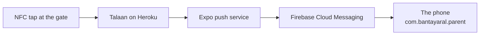

# Learning log

Short, plain-language answers to things that came up while building. Organised by topic, newest entry at the end of its section.

## Contents

- [Setting up the machine](#setting-up-the-machine)
  - [nvm installs a Node version without switching to it](#nvm-installs-a-node-version-without-switching-to-it)
- [Builds and installing the app](#builds-and-installing-the-app)
  - [Can the app get real pushes without the Play Store?](#can-the-app-get-real-pushes-without-the-play-store)
  - [APK or AAB: only one of them installs by hand](#apk-or-aab-only-one-of-them-installs-by-hand)
  - [How many free EAS builds we get](#how-many-free-eas-builds-we-get)
  - [What the owner sees on the phone when installing by hand](#what-the-owner-sees-on-the-phone-when-installing-by-hand)
  - [Google's developer verification, and why it matters by 2027](#googles-developer-verification-and-why-it-matters-by-2027)
  - [Expo Go runs one SDK, and the store copy lags](#expo-go-runs-one-sdk-and-the-store-copy-lags)
- [Push notifications](#push-notifications)
  - [Why Expo Go can't test push](#why-expo-go-cant-test-push)
  - [Why a push can arrive late, or not at all, on a cheap Android phone](#why-a-push-can-arrive-late-or-not-at-all-on-a-cheap-android-phone)

## Setting up the machine

### nvm installs a Node version without switching to it

`nvm install 24.11.0` downloads a version. It does **not** start using it. Switching is a second command, and on Windows it needs an **Administrator** terminal, because it rewrites the link at `C:\Program Files\nodejs` that `node` actually resolves to:

```powershell
nvm use 24.11.0
node -v            # expect v24.11.0
```

Without admin rights the switch fails quietly and `node -v` keeps reporting the old version, which looks exactly like the install having failed. It didn't — check `C:\Users\<you>\AppData\Roaming\nvm` and you'll see both versions sitting there.

How to tell what's really going on, from any terminal:

```powershell
Get-Item "C:\Program Files\nodejs" | Select-Object Target   # which version is live
Get-ChildItem "$env:NVM_HOME" -Directory                    # which versions exist
```

A version switch also doesn't reach terminals that are already open. Close and reopen them, this editor included, or they keep the old `node` on their `PATH`.

## Builds and installing the app

### Can the app get real pushes without the Play Store?

Yes. Installing the app by hand (copying an `.apk` to the phone and tapping it) gives you the same push notifications as a Play Store install. The Play Store is a shop, not a requirement.

The push travels like this:



Nothing in that chain asks where the app came from. Two things are easy to mix up:

- **Google Play *Services*** is a set of Google components already on the phone. Firebase Cloud Messaging needs it, because it is the part of the phone that holds the always-open connection to Google and wakes our app. Nearly every Android phone sold in the Philippines has it.
- **The Google Play *Store*** is distribution: a listing, a US$25 one-time fee, a privacy policy, a review. We need none of that to receive a push.

What ties a push to our app is the **package id** `com.bantayaral.parent`, registered in a free Firebase project. Firebase matches by package id, never by where the app was installed from. This is why `CLAUDE.md` calls the package id permanent: change it and every registered phone stops receiving.

Everything M7 needs is free: an Expo account, an EAS project id, and a Firebase project with an Android app on that package id.

### APK or AAB: only one of them installs by hand

EAS Build makes an **`.aab`** (Android App Bundle) by default for Android, and *an `.aab` cannot be installed on a phone*. It is a package for the Play Store to slice up. Handing one to the owner's phone just fails.

For a build to install by hand, `eas.json` has to ask for an APK:

```json
{
  "build": {
    "preview": {
      "android": {
        "buildType": "apk"
      }
    }
  }
}
```

Setting `distribution: "internal"` or `developmentClient: true` on a profile also produces an APK. M8's installable build needs this; it is the single easiest thing to get wrong.

### How many free EAS builds we get

The free plan gives **15 Android builds a month** (it was 30 until 2025-10-09, so older guides are wrong). Builds that fail in under 3 minutes don't count. Free builds use the low-priority queue, which can wait 90 minutes or more at busy times.

15 is enough for M1 to M8 if we aren't careless, but M7 is the step that burns builds, because a push problem often can't be seen without a new build. If we run out, a local build with Android Studio is free and unlimited (`CLAUDE.md`, "Stack"), just slower to set up.

### What the owner sees on the phone when installing by hand

Three prompts, all normal:

1. **"Install unknown apps"** — Android asks permission for the app you're installing *from* (Files, Chrome, Drive), not for our app. Granted once per source.
2. **Play Protect: "Unsafe app blocked"** or a scan prompt — because the app isn't signed by a known developer. Choose "Install anyway" / "More details". Expected for an unlisted app.
3. **The notification permission** (Android 13 and newer) — this one is ours, and M7 asks for it right after the first child is linked, never at first launch.

### Google's developer verification, and why it matters by 2027

Google now requires developers to verify their identity for apps installed on certified Android devices, **including apps installed by hand**. Enforcement began 2026-09-30 in Brazil, Indonesia, Singapore and Thailand, and Google says it expands globally in 2027.

Where this leaves us:

- **The Philippines is not in the first wave,** so installing by hand works normally today (checked 2026-10-21). The demo is unaffected.
- A free **Limited Distribution account** lets students, teachers and hobbyists share an app with **up to 20 devices**, with no government ID and no fee. That covers the demo and a small trial.
- 20 devices does **not** cover a 500-student pilot. When global enforcement lands, a pilot that size needs either a verified developer account or the Play Store (the US$25 one-time fee, plus a privacy policy page).

So: hand-installing is right for the demo and fine for a small trial, but the 500-student rollout should plan on Google Play. That is already on `docs/PLAN.md`'s after-the-demo list; the new part is that 2027 puts a clock on it.

### Expo Go runs one SDK, and the store copy lags

Expo Go is a single app that can only open projects built for **one** SDK
version. It is not backwards or forwards compatible. When the SDK your project
uses and the SDK your Expo Go supports don't match, the phone says:

> Project is incompatible with this version of Expo Go

The wording blames the project, which is misleading. Usually nothing is wrong
with it.

The part that catches people out is the timing. A new SDK is released, but the
matching Expo Go has to pass Google's and Apple's review before it reaches the
stores — days, sometimes weeks. During that gap:

| | Expo Go in the Play Store | A project on the new SDK |
|---|---|---|
| Right after a release | still the **old** SDK | refused |
| A few weeks later | the **new** SDK | works, and old-SDK projects break instead |

So "use the newest SDK so Expo Go keeps working" is right in the long run and
wrong during that window. We hit exactly this: SDK 58 came out on 2026-10-15
and its Expo Go still wasn't in the Play Store on 2026-10-21.

**How to check, instead of guessing.** Expo publishes a signed Expo Go APK for
every SDK, listed here:

```
https://api.expo.dev/v2/versions/latest
```

Each entry has an `androidClientUrl` pointing at an APK on Expo's own GitHub
releases. Download that on the phone and install it — the same hand-installing
as [[can-the-app-get-real-pushes-without-the-play-store]]. It replaces whatever
Expo Go is already there.

**This stops mattering at M7.** A development build carries its own copy of the
runtime, so it never consults Expo Go and never cares which SDK the stores are
on.

## Push notifications

### Why Expo Go can't test push

Expo Go is Expo's own app, so on Android it carries Expo's package id and Expo's Firebase setup, not ours. From Expo SDK 53 onward it can't receive pushes on Android at all. Push testing always needs a real build of *our* app — a development build in M7, or the installable APK in M8. This is why M7 lists "a development build installed on the phone" before anything else.

### Why a push can arrive late, or not at all, on a cheap Android phone

Two causes worth knowing before the demo, neither of them our bug:

- **The phone maker's battery saver.** Xiaomi, Oppo, Vivo, Realme, Infinix and Tecno — the phones most parents in Balanga will actually own — kill background apps harder than stock Android does, which delays or drops pushes. The fix is per phone: exempt Bantay Aral from battery optimisation in Android's settings. Worth doing on every demo phone, and worth telling parents once the pilot starts.
- **No Google Play Services at all.** Huawei phones sold after 2019 ship without it, so Firebase Cloud Messaging can never reach them. There is no workaround in our app; it would need Huawei's own push service. Rare, but it exists in the Philippines, so don't demo on a Huawei.

If a push doesn't arrive, `docs/SERVER.md` ("Testing a real push") lists what to check on the server side, and anything new goes in `docs/PROBLEMS-LOG.md`.
