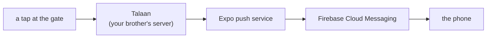

# Push notifications: the setup

Everything the owner does by hand before M7's code can work. Roughly half an
hour, all free, no card.

**Why Firebase is involved at all** is explained in `docs/LEARNING-LOG.md`,
"Why push needs Firebase at all". The short version: Android gives every app
one shared doorway for notifications, and Firebase Cloud Messaging is its
name. We use it as a pipe and nothing else — no Firebase database, no Firebase
sign-in, no analytics.



## What you need first

- A **Google account** (any Gmail address) for Firebase.
- An **email address** for Expo. It can be the same one.
- Your Android phone, and a cable or Wi-Fi to get a file onto it.

## Two things that cannot be undone

Read these twice before starting.

1. **The Android package name must be exactly `com.bantayaral.parent`.**
   Firebase says it is "case-sensitive and can't be changed later", and FCM
   matches our app by it. Get it wrong and push silently never works; change
   it later and push dies on every phone that already installed the app.
2. **The Expo access token and the Firebase service account key go on the
   server, never in this app.** Anything in this app's `.env` ends up readable
   inside the APK a parent downloads. `.gitignore` already blocks both files —
   leave it that way.

---

## Part A — Expo account

1. Go to **https://expo.dev/signup** and create an account. Free; no card.
2. Verify the email it sends you.
3. In a terminal, in this project:

   ```powershell
   npx eas login
   ```

   It asks for the username and password you just made.

4. Create the EAS project:

   ```powershell
   npx eas init
   ```

   It asks to create a project — say yes. It prints a **project ID**, a long
   string like `a1b2c3d4-...`. **Copy it somewhere**; the next step needs it.

   > `eas init` normally writes the ID into `app.json`. This project uses
   > `app.config.ts`, which it cannot edit, so the ID is added by hand. Tell
   > Claude the ID and it goes into `app.config.ts` under
   > `extra.eas.projectId`. A project ID is not a secret — it is safe to paste
   > in chat, unlike the access token below.

---

## Part B — Firebase project

1. Go to **https://console.firebase.google.com** and sign in with your Google
   account.
2. Click **Add project** (or **Create a project**).
3. Name it something you will recognise — `bantay-aral` is fine. Firebase makes
   its own project ID underneath; that does not matter to us.
4. Accept the terms, click **Continue**.
5. **Google Analytics: turn it off.** We do not use it, and CLAUDE.md requires
   your approval before any analytics touches a minor's data. Fewer moving
   parts.
6. Click **Create project**, then **Continue** when it finishes.

### Register the Android app

7. On the project overview page, click the **Android** icon (or **Add app**,
   then Android).
8. In **Android package name**, type exactly:

   ```
   com.bantayaral.parent
   ```

   No trailing space. This is the field that cannot be changed later.

9. **App nickname** is optional — "Bantay Aral parent app" is fine.
10. Leave the debug signing certificate **blank**. It is only needed for
    Google Sign-In, which we do not use.
11. Click **Register app**.
12. Click **Download google-services.json**.
13. Put that file in the **root of this project**, beside `package.json`:

    ```
    talaan_mobile/google-services.json
    ```

    `.gitignore` already excludes it, so it will not be committed. Good.

14. Firebase then shows Gradle instructions. **Skip all of them** and click
    **Next** → **Continue to console**. Expo does that part for us.

---

## Part C — let Expo send through Firebase

Expo needs a key proving it may send notifications as our app.

1. Still in the Firebase console, click the **gear icon** (top left, beside
   *Project Overview*) → **Project settings**.
2. Open the **Service accounts** tab.
3. Click **Generate new private key**, then **Generate key** in the dialog.
4. A `.json` file downloads. **This one is a password.** Anyone holding it can
   send notifications as Bantay Aral.
   - Put it somewhere outside this project, or in the project root where
     `.gitignore` already blocks `*-service-account*.json`.
   - Never email it, never paste it in chat, never commit it.
5. Back in the terminal:

   ```powershell
   npx eas credentials
   ```

   Then choose, in order:

   - **Android**
   - **production**
   - **Google Service Account**
   - **Manage your Google Service Account Key for Push Notifications (FCM V1)**
   - **Set up a Google Service Account Key for Push Notifications (FCM V1)**
   - **Upload a new service account key**

   If it finds the JSON file in the project folder it offers it — press **Y**.

---

## Part D — the development build

Expo Go cannot receive push on Android, so from here the app runs as a real
APK on your phone. This is also the rehearsal for M8's demo build.

1. Claude adds an `eas.json` with a `development` profile.
2. Build it:

   ```powershell
   npx eas build --profile development --platform android
   ```

   The first build asks a few questions (it offers to make a keystore — say
   yes, Expo keeps it). It then builds **on Expo's servers**, not your laptop:
   10–20 minutes on the free plan, longer at busy times.

   Free plan: **15 Android builds a month** (`docs/LEARNING-LOG.md`).

3. When it finishes it prints a URL and a QR code. Open the URL **on the
   phone**, download the APK, tap it.
   - Android asks to allow installs from your browser — allow it.
   - Play Protect warns about an unknown developer — **Install anyway**.
4. Then, on the laptop:

   ```powershell
   npx expo start --dev-client
   ```

   Open the new **Bantay Aral** app on the phone (not Expo Go) and it connects
   the same way.

---

## Part E — your brother's server

The backend currently builds each push and only writes it to a log. Nothing
reaches a phone until someone flips it.

He needs to set two environment variables wherever Talaan runs now:

```
PUSH_SENDER=expo
EXPO_ACCESS_TOKEN=<from expo.dev → Account settings → Access tokens>
```

- Create the access token at **https://expo.dev/settings/access-tokens**.
- **He types it on the server himself.** It never comes near this repository,
  this app's `.env`, or a chat window.

> `docs/SERVER.md` still says to do this with `heroku config:set`. That is out
> of date — the server moved and now answers at `https://bantayaral.com`
> (`docs/PROBLEMS-LOG.md`, P-007). Ask him where it runs and how to set
> environment variables there.

---

## What it costs

| | |
|---|---|
| Firebase Cloud Messaging | Free on the Spark plan — no card, no message quota |
| Expo account and push service | Free |
| EAS builds | Free, 15 Android builds a month |
| Google Play | **Not needed.** The demo installs by hand |

The only money anywhere near this is Google Play's one-off US$25, and that is
for publishing later, not for the demo.

---

## When it does not work

| What you see | Where to look |
|---|---|
| "No projectId found" | `extra.eas.projectId` missing from `app.config.ts` (Part A step 4) |
| Build fails on `google-services.json` | It is not in the project root, or `app.config.ts` does not point at it |
| Build succeeds, no notification ever arrives | The package name in Firebase is not exactly `com.bantayaral.parent` |
| Nothing arrives, server log says `push: sent 0` | The child has no linked parent with a live push address, or the school's setting is "off" |
| Server log shows `InvalidCredentials` or `MismatchSenderId` | The FCM key in Expo belongs to a different Firebase project (Part C) |
| Nothing arrives and the phone is a Huawei | No Google Play Services, so FCM cannot reach it at all. Use another phone |

Receipts take about 15–20 minutes to come back, so a problem in the last two
rows will not show in the server log immediately.

Anything new goes in `docs/PROBLEMS-LOG.md`.
