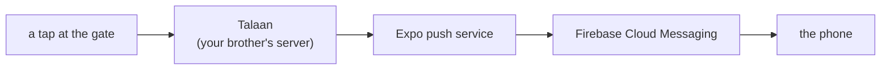
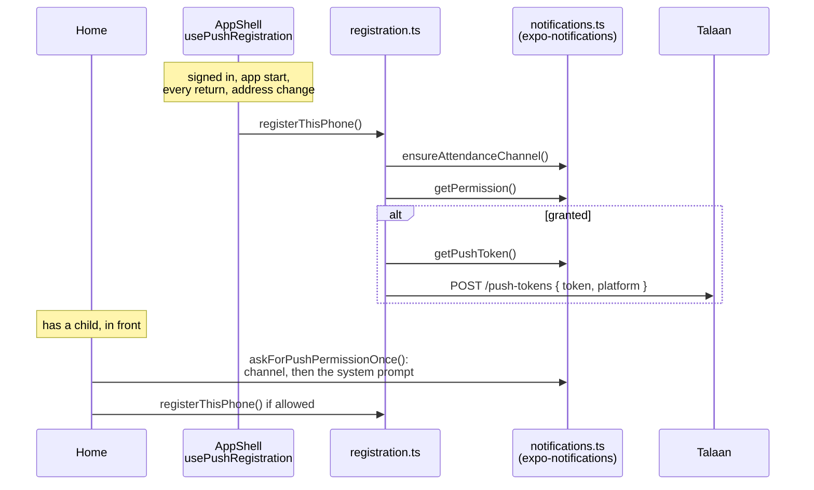
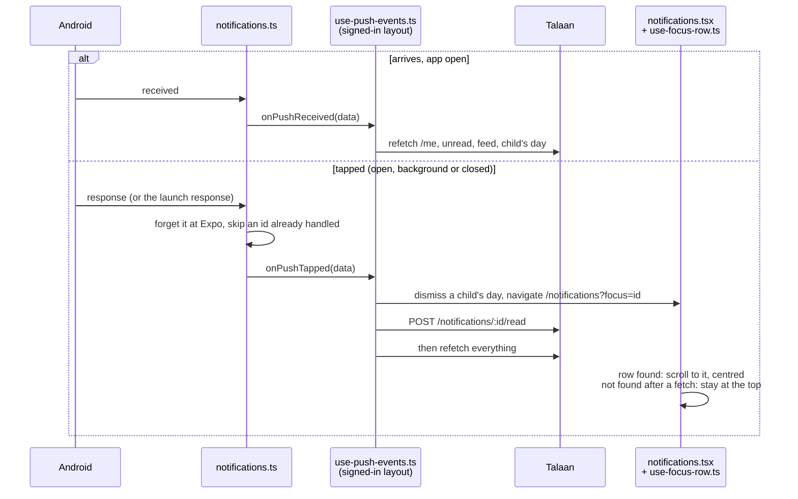

# Push notifications

Parts A to E are everything the owner does by hand before M7's code can work.
Roughly half an hour, all free, no card. "How the app's push works", after
them, is the code (M7a).

**Why Firebase is involved at all** is explained in `docs/LEARNING-LOG.md`,
"Why push needs Firebase at all". The short version: Android gives every app
one shared doorway for notifications, and Firebase Cloud Messaging is its
name. We use it as a pipe and nothing else — no Firebase database, no Firebase
sign-in, no analytics.



## What you need first

- A **Google account** (any Gmail address) for Firebase.
- An **email address** for Expo. It can be the same one.
- Your Android phone, and a cable or Wi-Fi to get a file onto it.

## Two things that cannot be undone

Read these twice before starting.

1. **The Android package name must be exactly `com.bantayaral.parent`.**
   Firebase says it is "case-sensitive and can't be changed later", and FCM
   matches our app by it. Get it wrong and push silently never works; change
   it later and push dies on every phone that already installed the app.
2. **The Expo access token and the Firebase service account key go on the
   server, never in this app.** Anything in this app's `.env` ends up readable
   inside the APK a parent downloads. `.gitignore` already blocks both files —
   leave it that way.

---

## Part A — Expo account

1. Go to **https://expo.dev/signup** and create an account. Free; no card.
2. Verify the email it sends you.
3. In a terminal, in this project:

   ```powershell
   npx eas login
   ```

   It asks for the username and password you just made.

4. Create the EAS project:

   ```powershell
   npx eas init
   ```

   It asks to create a project — say yes. It prints a **project ID**, a long
   string like `a1b2c3d4-...`. **Copy it somewhere**; the next step needs it.

   > `eas init` normally writes the ID into `app.json`. This project uses
   > `app.config.ts`, which it cannot edit, so the ID is added by hand. Tell
   > Claude the ID and it goes into `app.config.ts` under
   > `extra.eas.projectId`. Run `npx eas init` again afterwards: it then asks
   > for `owner` (your Expo username), which goes in `app.config.ts` too. A
   > third run says "Project already linked" with no warning. Neither value is
   > a secret — both are safe to paste in chat, unlike the access token below.

---

## Part B — Firebase project

1. Go to **https://console.firebase.google.com** and sign in with your Google
   account.
2. Click **Add project** (or **Create a project**).
3. Name it something you will recognise — `bantay-aral` is fine. Firebase makes
   its own project ID underneath; that does not matter to us.
4. Accept the terms, click **Continue**.
5. **Google Analytics: turn it off.** We do not use it, and CLAUDE.md requires
   your approval before any analytics touches a minor's data. Fewer moving
   parts.
6. Click **Create project**, then **Continue** when it finishes.

### Register the Android app

7. On the project overview page, click the **Android** icon (or **Add app**,
   then Android).
8. In **Android package name**, type exactly:

   ```
   com.bantayaral.parent
   ```

   No trailing space. This is the field that cannot be changed later.

9. **App nickname** is optional — "Bantay Aral parent app" is fine.
10. Leave the debug signing certificate **blank**. It is only needed for
    Google Sign-In, which we do not use.
11. Click **Register app**.
12. Click **Download google-services.json**.
13. Put that file in the **root of this project**, beside `package.json`:

    ```
    talaan_mobile/google-services.json
    ```

    `.gitignore` already excludes it, so it will not be committed. Good.

14. Firebase then shows Gradle instructions. **Skip all of them** and click
    **Next** → **Continue to console**. Expo does that part for us.

---

## Part C — let Expo send through Firebase

Expo needs a key proving it may send notifications as our app.

1. Still in the Firebase console, click the **gear icon** (top left, beside
   *Project Overview*) → **Project settings**.
2. Open the **Service accounts** tab.
3. Click **Generate new private key**, then **Generate key** in the dialog.
4. A `.json` file downloads. **This one is a password.** Anyone holding it can
   send notifications as Bantay Aral.
   - Its name looks like `bantayaral-58731-firebase-adminsdk-fbsvc-….json`.
     `.gitignore` blocks `*-firebase-adminsdk-*.json`; check with
     `git status` that it isn't listed before going on.
   - Never email it, never paste it in chat, never commit it.
   - Once uploaded (step 5), move it out of this project, for example to
     `~/Documents/secrets/`. Expo keeps its own copy.
5. `eas credentials` needs `eas.json`, which is in the project since Part C
   (it was planned for Part D, and the command failed without it). Back in the
   terminal:

   ```powershell
   npx eas credentials
   ```

   Then choose, in order:

   - **Android**
   - **production**
   - **Google Service Account**
   - **Manage your Google Service Account Key for Push Notifications (FCM V1)**
   - **Set up a Google Service Account Key for Push Notifications (FCM V1)**
   - **Upload a new service account key**

   If it finds the JSON file in the project folder it offers it — press **Y**.

   > Choosing **production** here doesn't tie the key to production builds.
   > Expo stores the FCM key against the package name, `com.bantayaral.parent`,
   > which every profile shares, so the development build uses it too. To see
   > it: `eas credentials` → Android → development, and the same key is listed
   > under "Push Notifications (FCM V1)".

---

## Part D — the development build

Expo Go cannot receive push on Android, so from here the app runs as a real
APK on your phone. This is also the rehearsal for M8's demo build.

1. **Before the first build.** A build bakes in every native package and
   every setting in `app.config.ts`. JavaScript changes after it arrive over
   Wi-Fi, but a native change means another build (15 a month). So all of
   this is in place first:

   | What | Done by | How |
   |---|---|---|
   | `expo-dev-client` and `expo-notifications` | Claude, 2026-10-28 | `npx expo install expo-dev-client expo-notifications` |
   | `expo-notifications` in `app.config.ts` → `plugins` | Claude | edited by hand |
   | `android.googleServicesFile` in `app.config.ts` | Claude | edited by hand |
   | `eas.json`, `development` profile | Claude, in Part C | written by hand |
   | `google-services.json` uploaded to EAS | **you** | the command below |

   `.gitignore` keeps `google-services.json` off GitHub, and EAS only uploads
   what git would, so the build server needs its own copy. In the project
   folder:

   ```bash
   eas env:set --name GOOGLE_SERVICES_JSON --type file --value ./google-services.json --visibility secret --environment development --environment preview --environment production
   ```

   Then check it's there:

   ```bash
   eas env:list --environment development
   ```

   It should list `GOOGLE_SERVICES_JSON`. During a build, EAS writes the file
   on its server and puts its path in that variable; `app.config.ts` reads it.

2. Build it:

   ```powershell
   eas build --profile development --platform android
   ```

   The first build asks a few questions (it offers to make a keystore — say
   yes, Expo keeps it). It then builds **on Expo's servers**, not your laptop:
   10–20 minutes on the free plan, longer at busy times.

   Free plan: **15 Android builds a month** (`docs/LEARNING-LOG.md`).

3. When it finishes it prints a URL and a QR code. Open the URL **on the
   phone**, download the APK, tap it.
   - Android asks to allow installs from your browser — allow it.
   - Play Protect warns about an unknown developer — **Install anyway**.
4. Then, on the laptop:

   ```powershell
   npx expo start --dev-client
   ```

   Open the new **Bantay Aral** app on the phone (not Expo Go) and it connects
   the same way.

---

## Part E — your brother's server

The backend currently builds each push and only writes it to a log. Nothing
reaches a phone until someone flips it.

He needs to set two environment variables wherever Talaan runs now:

```
PUSH_SENDER=expo
EXPO_ACCESS_TOKEN=<from expo.dev → Account settings → Access tokens>
```

- Create the access token at **https://expo.dev/settings/access-tokens**.
- **He types it on the server himself.** It never comes near this repository,
  this app's `.env`, or a chat window.

> Done on 2026-10-28: the live server at `https://bantayaral.com` sends real
> pushes (`docs/SERVER.md`, "Testing a real push").

---

## How the app's push works (M7a)

Done by the owner on 2026-10-28: Parts A to E. Everything below is code.



| File | Its job |
|---|---|
| `src/push/notifications.ts` | The only file that imports `expo-notifications`. Channel, permission, the push address, stopping push. Every function fails soft: a phone that can't do push gets `null`, never a crash |
| `src/push/registration.ts` | `registerThisPhone()`: channel → permission → address → `POST`. One run at a time, shared by every caller |
| `src/push/use-push-registration.ts` | Mounted once in `src/app/_layout.tsx`. Runs registration while signed in: at start, on every return to the foreground (TanStack's `focusManager`, the same signal as `/me`), and when the phone's address changes |
| `src/push/ask-permission.ts` | Asks "Allow notifications?" at most once per app session, while Android still lets the app ask (`canAskAgain`, not `status`: P-018) |
| `src/push/use-ask-permission.ts` | Used on Home: asks once the parent has a child and Home is the screen in front |
| `src/api/endpoints.ts` | `registerPushToken({ token, platform })` |
| `src/auth/session.ts` | Sign-out waits for a running registration, then calls `stopPushOnThisPhone()`: deletes the channel (works offline) and drops the Firebase token (3 seconds at most). P-016 |

**Rules the code keeps**
- The channel comes first. The server sends to `attendance`, and Android drops
  a push for a channel the phone doesn't have. Android 13 also shows the
  permission prompt only once a channel exists.
- The push address is never logged. With it, anyone can send this parent a
  notification.
- The address the token listener hands over is Firebase's, not Expo's, so it
  is ignored and the Expo one asked for again.
- Failures are quiet. The next return to the app tries again.
- The channel's lock-screen setting isn't set: the phone's own setting decides
  (owner decision, 2026-10-28). Android fixes it when the channel is first
  made, so changing it later means a new channel id.

M7b adds what happens when a push arrives with the app open, and when one is
tapped: "A push with the app open, and a tap (M7b)", below.

### What a push looks like (M7c)

With the app closed, Android draws the push itself, from two things: the words
the server sends and an icon built into the app.

```
┌───────────────────────────────────────────────┐
│ (A)  Bantay Aral · now                   (B)  │
│      Juan               ← the server's title  │
│      Tapped in at 7:56 AM                     │
└───────────────────────────────────────────────┘
```

| Spot | What Android allows | What the app sets |
|---|---|---|
| (A) left, and the status bar | One colour: Android keeps only the picture's shape | `assets/images/notification-icon.png` (96 × 96, the mark as a white outline, from `design/logo/`), in a circle of the mark's blue `#1149A6` |
| (B) right | Full colour, optional | Nothing: the mark would show twice (owner's choice "A", 2026-10-28). `design/logo/notification-large-icon.png` is ready if that changes |
| The title and the message | The server's words: the child's first name, then the rest | Nothing. Changed by Talaan in Step 59.6 (`docs/API-REQUESTS.md`, items 5 and 8) |

Both come from `app.config.ts`:

```ts
[
  "expo-notifications",
  {
    icon: "./assets/images/notification-icon.png",
    color: NOTIFICATION_COLOR, // "#1149A6", checked against src/theme by app.config.test.ts
  },
],
```

The same file is used in light and dark: Android colours it. The icon is built
into the app, so changing it needs a new development build. A picture of the
child isn't possible without a photo link that works without signing in
(`docs/API-REQUESTS.md`, item 5).

### A push with the app open, and a tap (M7b)

Two moments, both handled in JavaScript on top of the native code already in
the build, so no new build was needed.

**A push arrives while the app is open.** Expo shows nothing in that case
unless the app says how. `showPushesWhileOpen()` says: a banner, in the list,
with sound, no app-icon badge, so it looks exactly like one with the app
closed. It's called once, at the top of `src/app/_layout.tsx`. Then the screens
catch up: Home (`/me`), the badge, the feed and that child's day are asked for
again.

**The parent taps a push.** With the app open, in the background, or closed.
It's marked read (`POST /notifications/:id/read`), since they've seen it, then
the Notifications tab opens with `?focus=<notificationId>` and scrolls to that
row. A link notice works the same way and never opens a child's day: it isn't
a tap (P-013).



| File | Its job |
|---|---|
| `src/push/notifications.ts` | `showPushesWhileOpen()`, `onPushReceived()`, `onPushTapped()`. Checks each push's `data` with Zod: `{ notificationId, childId }`, anything else ignored. Unreadable data still opens the feed, at the top |
| `src/push/use-push-events.ts` | Mounted in `src/app/(app)/_layout.tsx`: refreshes on arrival; on a tap, opens the feed, marks it read, then refreshes |
| `src/feed/use-focus-row.ts` | Scrolls the feed to `focus`, then clears it |
| `src/feed/feed-groups.ts` | `locateInSections()`: which section and row a notification is in |

**Rules the code keeps**
- **Mounted in the signed-in layout, not the app shell.** On a cold start from
  a push, the shell's gate first moves the parent from "/" to Home. A hook in
  the shell could navigate to the feed at the same moment and lose the race.
  In the signed-in layout it only runs once the gate is done, and never while
  signed out.
- **A tap is handled once.** Expo can report the tap that opened the app both
  as the "last response" and to the listener, and keeps the last response
  until told to forget it. So every tap is forgotten at once
  (`clearLastNotificationResponse()`) and its id remembered: signing out and
  back in can't replay an old tap.
- **Read mark first, then refetch.** A feed fetched before the read mark lands
  would show the row unread again.
- **A child's day open on top is closed first** (`dismissAll()`), so Back from
  the feed goes Home, not to a second set of tabs.
- **The feed isn't paged through to find a row.** If it's not in the rows
  already loaded, the feed stays at the top. A fresh push is almost always the
  first row under Today anyway.
- **`focus` is always cleared**, once the row is found, or once a fetch after
  the tap ends without it. Left set, a later pull to refresh would jump the
  list.
- **`itemIndex + 1`.** A `SectionList` counts each section's header as its
  item 0 (`VirtualizedSectionList.js`, `scrollToLocation`).
- **A row not drawn yet** fails to scroll the first time (rows have no fixed
  height). The list jumps to about where it should be (`index ×
  averageItemLength`), which makes it draw the row, then tries once more.

**Known trade-offs**
- Tapping a push while linking a child closes the half-filled form
  (`dismissAll()`), against the "never lose what was typed" rule. Accepted for
  now: it's a deliberate tap (owner, 2026-10-29).
- If the cached feed is older than 30 seconds, opening it fetches once before
  the read mark and once after: the row shows unread for a moment, then read.

### Quick recipes

| I want to | Do |
|---|---|
| See whether this phone registered | The server's log: `POST /api/v1/parents/push-tokens` → `204` after sign-in |
| Be asked "Allow?" again | Settings → Apps → Bantay Aral → Storage → Clear storage (signs you out too), or uninstall and reinstall the build |
| Turn notifications back on after "Don't allow" | Settings → Apps → Bantay Aral → Notifications |
| Change the channel's sound or importance | Use a new channel id; the server must send to it too (`docs/API-REQUESTS.md`) |
| Change anything in `app.config.ts` or add a native package | A new development build (Part D, step 2) |
| Open the feed somewhere from code | `router.navigate({ pathname: "/notifications", params: { focus: id } })`: scrolls to that notification if it's loaded |
| Test a tap from closed | Swipe the app away, make a tap at the gate, tap the push: the feed opens at that row |
| Change the push icon | Replace `assets/images/notification-icon.png` with a 96 × 96 white shape on transparent, keeping about 8 pixels clear at each edge, then a new development build |

---

## What it costs

| | |
|---|---|
| Firebase Cloud Messaging | Free on the Spark plan — no card, no message quota |
| Expo account and push service | Free |
| EAS builds | Free, 15 Android builds a month |
| Google Play | **Not needed.** The demo installs by hand |

The only money anywhere near this is Google Play's one-off US$25, and that is
for publishing later, not for the demo.

---

## When it does not work

| What you see | Where to look |
|---|---|
| "No projectId found" | `extra.eas.projectId` missing from `app.config.ts` (Part A step 4) |
| Build fails on `google-services.json` | It is not in the project root, or `app.config.ts` does not point at it |
| Build succeeds, no notification ever arrives | The package name in Firebase is not exactly `com.bantayaral.parent` |
| Nothing arrives, server log says `push: sent 0` | The child has no linked parent with a live push address, or the school's setting is "off" |
| Server log shows `InvalidCredentials` or `MismatchSenderId` | The FCM key in Expo belongs to a different Firebase project (Part C) |
| Nothing arrives and the phone is a Huawei | No Google Play Services, so FCM cannot reach it at all. Use another phone |

Receipts take about 15–20 minutes to come back, so a problem in the last two
rows will not show in the server log immediately.

Anything new goes in `docs/PROBLEMS-LOG.md`.
