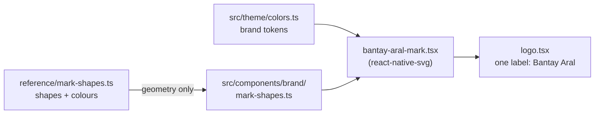

# Step M1 — Set up the project

A reproducible checklist, written from the real diff. Following it on a clean
machine gives the same result.

**What you end with:** an Expo app that opens on an Android phone in Expo Go,
showing the sign-in screen's look in the Bantay Aral theme, with the logo drawn
as vectors, both fonts loaded, and four checks that pass in CI.

## 0. The machine

```powershell
nvm install 24.11.0
nvm use 24.11.0          # Administrator PowerShell — it rewrites a system link
node -v                  # must print v24.11.0
```

`nvm install` does not switch versions, and the switch needs admin rights. See
`docs/LEARNING-LOG.md`.

> **Don't put the project inside OneDrive.** It corrupted four packages during
> this step, each presenting as a different and misleading error
> (`docs/PROBLEMS-LOG.md`, P-003).

## 1. Scaffold somewhere else first

```bash
npx --yes create-expo-app@latest scaffold --template default --no-install
```

Run it in a scratch folder, never over the repository. The generator writes
three things that must **not** reach this repo:

| What it writes | Why to leave it |
|---|---|
| `.git/` | The repository already has its own history |
| `.claude/settings.json` | Would replace the owner's, which blocks git commands |
| `AGENTS.md` | Not used here |

Copy in only these:

```bash
cp scaffold/tsconfig.json .
cp scaffold/.gitignore .
mkdir -p assets/images
cp scaffold/assets/images/icon.png assets/images/
cp scaffold/assets/images/splash-icon.png assets/images/
cp scaffold/assets/images/favicon.png assets/images/
cp scaffold/assets/images/android-icon-background.png assets/images/
cp scaffold/assets/images/android-icon-foreground.png assets/images/
cp scaffold/assets/images/android-icon-monochrome.png assets/images/
```

The example screens and components (`explore.tsx`, `themed-text`, `app-tabs`,
the React logos) are not copied — they would be dead code.

## 2. Extend .gitignore

```
.env
.env.local
google-services.json
google-services*.json
*-service-account*.json
```

The last three are for M7. They are added now so that a Firebase credential can
never be committed by accident later.

## 3. package.json

Start from the template's dependency versions. **Keep `react-dom` and
`react-native-web` even though the app is Android-only.** `expo-router` pulls
`react-dom` in transitively, and without the pin npm picks a newer one than
`react` and nothing resolves (P-001).

Drop as unused: `@expo/ui`, `expo-glass-effect`, `expo-symbols`,
`expo-web-browser`. Defer to the step that needs them: `expo-image` (M5) and
`expo-device` (M3).

```powershell
npm install
npx expo install react-native-svg @expo-google-fonts/lexend @expo-google-fonts/atkinson-hyperlegible
npx expo install --dev jest-expo jest eslint-config-expo
npm install --save-dev @testing-library/react-native @types/jest eslint prettier
```

Add to `package.json`:

```json
"engines": { "node": ">=24.3" },
"scripts": {
  "lint": "expo lint",
  "typecheck": "tsc --noEmit",
  "test": "jest",
  "check:colors": "node scripts/check-color-literals.mjs"
}
```

## 4. tsconfig.json

`"types": ["jest"]` is required. Without it TypeScript does not pick up the Jest
globals, and every `describe`, `test` and `expect` is an error even though
`@types/jest` is installed.

```json
{
  "extends": "expo/tsconfig.base",
  "compilerOptions": {
    "strict": true,
    "types": ["jest"],
    "paths": { "@/*": ["./src/*"], "@/assets/*": ["./assets/*"] }
  },
  "include": ["**/*.ts", "**/*.tsx", ".expo/types/**/*.ts", "expo-env.d.ts"]
}
```

## 5. app.config.ts

**It cannot import from `src/`.** Expo transpiles it to standalone CommonJS, so
`require("./src/product")` cannot resolve a TypeScript file, and every Expo
command fails — including unrelated ones such as `expo install` (P-002).

Write the values out, and let `app.config.test.ts` guard them:

```ts
const APP_ID = "com.bantayaral.parent";
const PRODUCT_NAME = "Bantay Aral";
const ICON_BACKGROUND = "#FFFFFF";
```

Set now, because each is expensive to change later:

| Field | Value | Why now |
|---|---|---|
| `android.package`, `ios.bundleIdentifier` | `com.bantayaral.parent` | Permanent once published; M7 registers it with Firebase |
| `scheme` | `bantayaral` | What a notification tap opens (M7) |
| `userInterfaceStyle` | `automatic` | Light and dark follow the phone |
| `android.permissions` | `[]` | Request nothing until a step needs it |
| `versionCode` | `1` | Every installable build increments it |

The icon and splash stay as Expo's placeholders. The real artwork is M8.

Check what Expo actually reads:

```powershell
npx expo config --type public
```

## 6. The theme

```
src/theme/colors.ts      11 semantic x 2 schemes, 5 status, 9 brand
src/theme/typography.ts  12/14/16/18/22/28, the two font families
src/theme/space.ts       4...48, corners 6/8/10/14, MIN_TOUCH_TARGET 48
src/theme/index.ts       useTheme()
```

`colors.ts` imports nothing. Keep it that way: it makes the file safe to read
from anywhere, including a script.

`contrast.test.ts` checks all 36 text pairs at WCAG AA. Assert only what
`docs/DESIGN.md` actually requires — 4.5:1 on text, 3:1 on large text and icons.
A first version also asserted a border threshold, which failed on perfectly
correct colours because a card's edge is meant to be subtle. The invented
assertion was removed rather than the threshold lowered.

## 7. The logo

`reference/mark-shapes.ts` **stays where it is**: `docs/PLAN.md:17` points at
that path, and its 15 colour literals would trip `check:colors` under `src/`.
Copy the geometry only, with `sed`, so nothing is mistyped:

```bash
sed -n '13,28p' reference/mark-shapes.ts >> src/components/brand/mark-shapes.ts
```

Colours come from the theme's brand tokens, so the copy holds no literal.



## 8. The colour check

`scripts/check-color-literals.mjs` scans `src/` for hex, `rgb()`/`rgba()` and
named colour strings outside `src/theme`. It skips `app.config.ts`, which the
config test covers instead.

**Prove it works before trusting it.** Temporarily add
`backgroundColor: "#FF0000"` to a component and run it: it must report the
finding and exit 1. A check that has never failed is not a check.

## 9. Tests

Two things about this toolchain are easy to lose an hour to:

1. **No Jest setup file.** React Native Testing Library has included its own
   matchers in the main export since v12.4. The old
   `@testing-library/react-native/extend-expect` entry point no longer exists,
   and requiring it fails every suite.
2. **`render` is async in v14 and must be awaited.** Without the await it
   returns a pending promise, which surfaces as "getByText is not a function",
   or as `screen` insisting that render was never called. Neither message
   points at the real cause.

```tsx
test("...", async () => {
  await render(<Screen />);
  expect(screen.getByText("Welcome back")).toBeTruthy();
});
```

## 10. Export before calling it done

```powershell
npx expo export --platform android
```

The only check that catches a test file leaking into the shipped app. Expo
Router turns **every** `.ts`/`.tsx` file under `src/app` into a route — there
is no exception for `.test.` or `__tests__` (`docs/PROBLEMS-LOG.md`, P-004).
Keep `src/app` for routes only; tests live anywhere else.

## 11. Checks

```powershell
npm run lint
npm run typecheck
npm run check:colors
npm test
```

All four run in CI on every push (`.github/workflows/ci.yml`), on the Node
version in `.nvmrc`.

## Dead ends

Two approaches were tried and abandoned. The full reasoning is in
`docs/BUILD-LOG.md`; in short:

1. **SDK 57 instead of 58** — abandoned because each Expo Go build ships exactly
   one SDK version and auto-updates to the newest, so an SDK 57 project would
   have forced a development build at M1.
2. **`app.config.ts` importing tokens from `src/`** — abandoned because Expo
   cannot load it (P-002). Replaced by written-out values plus a guard test.
