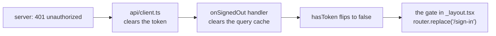

# Step M3 — Sign up, sign in, sign out

A reproducible checklist, written from the real diff.

**What you end with:** a parent can create an account, sign in, sign out, and
reopen the app tomorrow still signed in.

## 1. Packages

```powershell
npx expo install expo-device
npm install @tanstack/react-query react-hook-form @hookform/resolvers@^5.9.2
```

**Pin `@hookform/resolvers` to v5.** v6 cannot install alongside this tree: its
optional peer wants `effect@^4` while its own `@typeschema` dependencies pull
`effect@^3`. None of that is used — those peers are for Effect Schema, Valibot
and the rest — but npm still refuses. v5.9.2 lists `zod: ^3.25.0 || ^4.0.0`.

## 2. Routing

```
src/app/_layout.tsx        providers, fonts, focus tracking, the gate
src/app/index.tsx          "/" — a neutral "Checking your sign-in…" screen
src/app/(auth)/sign-in.tsx
src/app/(auth)/sign-up.tsx
src/app/(app)/home.tsx     "/home"
```

**A route group adds no path segment.** `(app)/index.tsx` is not `/app` — it is
`/`, which collides with `src/app/index.tsx`. Name it something, or do not have
a root screen. This is silent: nothing errors, the wrong screen just wins.

**Regenerate the typed routes before trusting `tsc`.** `npx expo export` does
*not* write `.expo/types/router.d.ts` — only the dev server does. Until it has
run once, every new `router.replace("/home")` is a type error about a route
that "does not exist":

```powershell
npx expo start        # let it boot, then stop it
npm run typecheck
```

## 3. One thing navigates

The gate in `_layout.tsx` is the only code in the app that moves a parent
between signed-out and signed-in. Everything else changes state:



Giving `onSignedOut` a `router.replace` as well means two things racing to move
the same parent. Keep it state-only.

The gate asks **"are they where they belong?"**, not "are they in the wrong
half?" — with a neutral `/`, the second question leaves a signed-in parent
sitting there forever:

```ts
const inAuthScreens = segments[0] === "(auth)";
const inAppScreens = segments[0] === "(app)";

if (!hasToken && !inAuthScreens) router.replace("/sign-in");
else if (hasToken && !inAppScreens) router.replace("/home");
```

## 4. The token decides which half; `/me` decides whether it is still good

Two questions, kept apart:

| | Answered by | Costs |
|---|---|---|
| Which half of the app? | is there a token in secure storage | nothing |
| Is the sign-in still valid? | `/me` | one request |

`useMe` is `enabled` only when a token exists, so a signed-out parent never
makes a request. `retry: false`, because the three outcomes want different
handling and retrying blurs them.

**A failed `/me` is not a sign-out.** Three outcomes, three behaviours:

| `/me` | What happens |
|---|---|
| answered | show the parent's name |
| `kind: "network"` | **stay signed in**, show "Try again" |
| `unauthorized` | the client already cleared the token; the gate moves them |

Never put the token's value in the query cache — only whether one exists. It
lives in `expo-secure-store` and nowhere else.

## 5. Foreground refetch

```ts
focusManager.setEventListener((handleFocus) => {
  const subscription = AppState.addEventListener("change", (status) => {
    handleFocus(status === "active");
  });
  return () => subscription.remove();
});
```

Query v5 does not wire React Native's app state itself — there is no browser
window to focus — so `refetchOnWindowFocus` would never fire. Going through
`focusManager` rather than refetching by hand matters: with both, every query
runs twice on each return. Give `/me` a `staleTime` (30s here) or an Android
permission dialog handing focus back repeatedly becomes a request storm.

Note `setEventListener` returns `void`, not a cleanup function.

## 6. `deviceLabel` — the privacy trap

```ts
export function deviceLabel(): string | undefined {
  return Device.modelName ?? undefined;   // "Pixel 7"
}
```

**Never `Device.deviceName`.** It is set by whoever owns the phone, and Expo's
own documented example is "Vivian's iPhone XS". This value is sent to the
server and kept there. Write the test that fails if someone swaps it back.

## 7. Forms

React Hook Form with `zodResolver`, and the schemas in
`src/auth/form-schemas.ts` carrying the exact messages from
`docs/PRODUCT-RULES.md` — the server sends the same words back, so they must
match.

Two React Native details:

- `onSubmitEditing={() => onSubmit()}`, not `={onSubmit}`. RHF's handler
  expects a web-ish event; RN passes a different one, and the types disagree.
- Do not `forwardRef<TextInput>` in RN 0.88 unless you need it — the instance
  type changed and the old form no longer typechecks.

The `409` email goes to sign-in through an in-memory module
(`src/auth/pending-email.ts`), **not** a route parameter. An email identifies a
parent, and a route parameter becomes navigation state — which is where
personal data ends up in a log without anyone deciding it should.

## 8. Checks

```powershell
npm run lint
npm run typecheck
npm run check:colors
npm test
npx expo export --platform android
```

On the phone: sign up, land on your name, sign out, sign in again. Then
**force-close and reopen** — straight to your name, no sign-in. Aeroplane mode
on a cold start should say "can't reach" and leave you signed in.
